  

  
  
  

 

## About me

I'm **Patience**, a **business intelligence and data analyst** who turns raw, messy data into validated warehouses, predictive models and Power BI dashboards that answer real business questions. My focus is **credit risk, fraud and customer analytics**: finding the few numbers that change a decision, and proving they hold up.

- 🔍 **Currently:** building out my portfolio, with more projects on the way
- 🏦 **Latest work:** an end-to-end banking analytics platform covering credit risk, fraud and customer segmentation
- 💬 **Ask me about:** SQL data-quality checks, credit scorecards, fraud rules and DAX
- 🤝 **Open to:** business intelligence, data analyst and risk analytics roles

 

## Tech stack

  

 

## Featured project

  

  
<b>🗄️ Data engineering &amp; quality</b>

   

  - Built a layered **PostgreSQL** warehouse (raw → clean → star schema) from raw CSVs, rebuilt end to end by **16 re-runnable SQL scripts**.
  - Designed a star schema with **5 dimensions and 6 facts**, including a loan × month snapshot for point-in-time arrears, roll-rate and vintage reporting, **reconciled to the shilling**.
  - Wrote data-quality rules that found **all 7 injected defect types with 100% precision** and accounted for every raw row (clean + duplicates removed + quarantined).

  
<b>📉 Credit risk</b>

   

  - Analysed a **KES 7.3bn loan book**: one product was **42% of lending but 63% of write-offs**, and 3 branches defaulted **45–70% above** what their product mix explained.
  - Built a leakage-free **logistic-regression default scorecard** (out-of-time **Gini 0.48**). Approving the best 85% of applicants cuts the bad-loan rate from **12.5% to 9.0%**.
  - Used roll-rate analysis to show **30 days past due is the tipping point** for recovery (57% vs 18%) and recommended contact within the first month.
  - Validated the scorecard out of time, checked calibration and **confirmed equal accuracy for women and men**.

  
<b>🚨 Fraud &amp; financial crime</b>

   

  - Audited the bank's existing alert rules: they caught **only 27% of fraud**, and **42% of reviews were false alarms**.
  - Designed **5 behavioural rules** (account takeover, structuring, rapid-fire transfers) and a prioritised review queue that would catch **68% more fraud with the same team at 97% precision**.
  - Recommended switching off a rule that produced **0 fraud from 532 reviews**, and automating real-time holds for two rules with 100% precision.

  
<b>👥 Customer analytics</b>

   

  - Segmented **50,000 customers with k-means**: **32% of customers generate 70% of transaction value**, which shaped retention and fraud-control recommendations.

  
<b>📊 Power BI dashboard</b>

   

  - **5-page** report across executive, credit, fraud, customer and data-quality views.
  - Library of **38 DAX measures**, including semi-additive month-end balances and inactive-relationship date analysis.
  - Custom **colour-blind-safe theme**, synced slicers and page navigation.

Built on a synthetic dataset as a personal portfolio project. More projects coming soon.

 

## GitHub activity

  
  

  

 

  Thanks for stopping by. Let's find the story in the data. 📊

